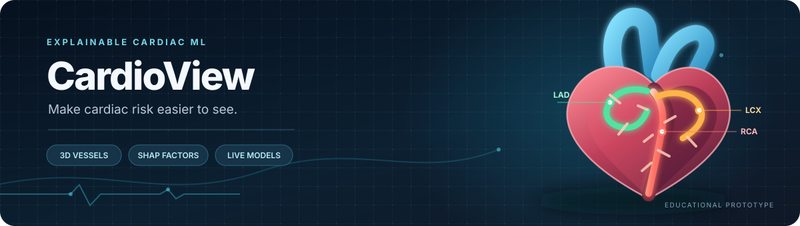
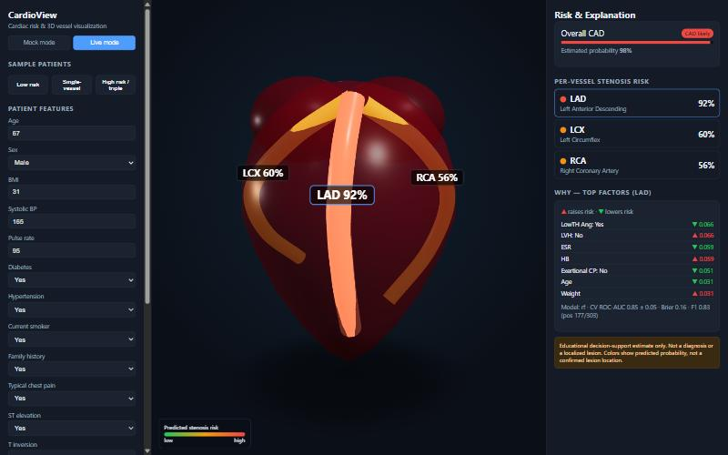
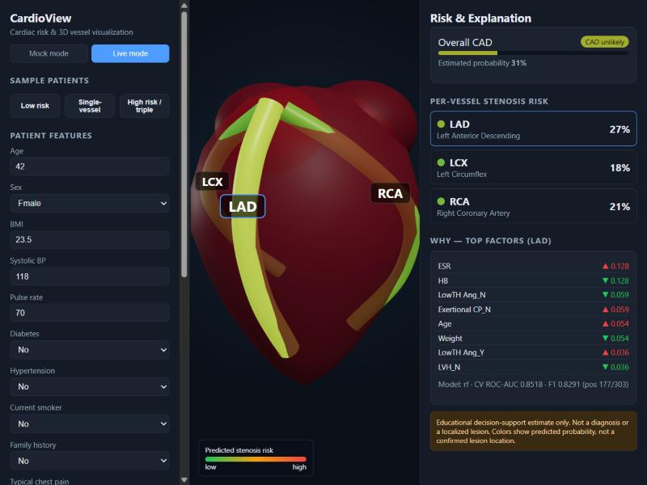
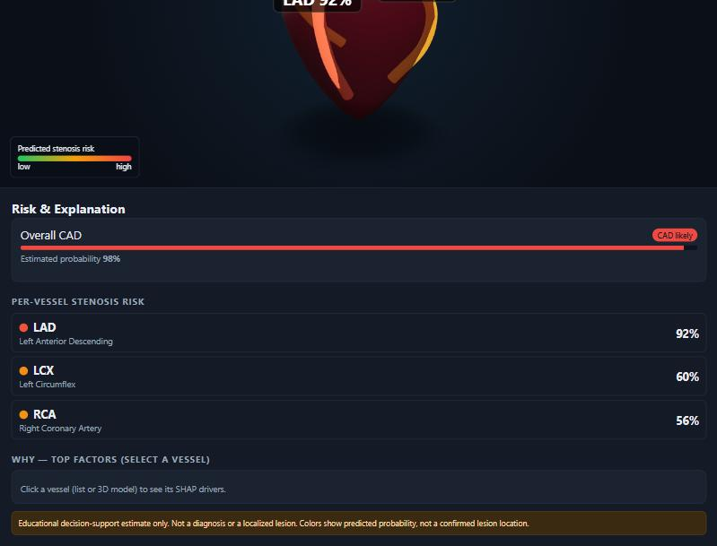

  
  
<strong>Interactive 3D cardiac risk visualization, with explanations you can inspect.</strong>

  

    
    
    
    
  

CardioView estimates overall coronary artery disease (CAD) status and stenosis probabilities for the LAD, LCX, and RCA. It maps those outputs onto a rotatable 3D heart and shows which patient features contributed most to each prediction.

> **Important:** CardioView is an educational prototype, not a medical device. Its probabilities are exploratory model outputs, not a diagnosis or a confirmed map of arterial lesions. Do not use them to make medical decisions.

## At a glance

- **Four predictions:** overall CAD, LAD, LCX, and RCA.
- **Interactive 3D view:** rotate and zoom the heart, select a vessel, and see its estimated probability.
- **Feature explanations:** inspect the strongest SHAP contributions for a selected prediction.
- **Two modes:** Mock mode lets you explore the interface without a backend; Live mode calls the trained models through FastAPI.
- **Transparent evaluation:** cross-validation metrics, their variability, and the positive-class counts are reported below.

## Screenshots

<table>
  <tr>
    <td width="34%" valign="top">
      
      <strong>High-risk example</strong> 
      Vessel probabilities and the selected vessel's strongest factors.
    </td>
    <td width="33%" valign="top">
      
      <strong>Low-risk example</strong> 
      A different sample profile produces a different set of outputs.
    </td>
    <td width="33%" valign="top">
      
      <strong>Responsive layout</strong> 
      The controls, heart, and explanation panel stack on narrower screens.
    </td>
  </tr>
</table>

## Model results

The figures below come from repeated stratified 5-fold cross-validation, with 5 repeats (25 validation fits per target). ROC-AUC is shown as the mean ± standard deviation across folds. F1 is the mean cross-validation F1 score; a lower Brier score indicates better probability calibration.

| Target | ROC-AUC (mean ± SD) | F1 | Brier score | Positive cases |
|---|---:|---:|---:|---:|
| Overall CAD | 0.923 ± 0.038 | 0.910 | 0.113 | 216 / 303 |
| LAD | 0.852 ± 0.047 | 0.829 | 0.165 | 177 / 303 |
| LCX | 0.720 ± 0.062 | 0.586 | 0.210 | 119 / 303 |
| RCA | 0.712 ± 0.050 | 0.524 | 0.210 | 114 / 303 |

These are **model-development cross-validation results, not independent test results or clinical validation**. The same CV procedure is used to compare candidate models, so the figures should be interpreted as development estimates. LCX and RCA are weaker than CAD and LAD on this dataset; the small sample and class counts limit how much can be inferred from them.

## How it works

1. **Enter a sample or patient feature profile.** The interface accepts the demographic, clinical, ECG, laboratory, and echocardiographic fields present in the dataset.
2. **Run the prediction pipeline.** Four scikit-learn classifiers estimate the overall CAD and vessel-specific outputs.
3. **Inspect the 3D view.** LAD, LCX, and RCA are separate tube geometries and update their colours based on estimated probability. Each vessel also displays a numeric percentage, so the result does not depend on colour alone.
4. **Read the explanation.** Select a vessel to review its strongest feature contributions and the model's cross-validation metrics.

The highlighted arteries are a visualization of model output. The dataset does not contain 3D coordinates for a patient's lesion, so the app does not claim to locate an actual blockage.

## Getting started

### Requirements

- Python 3.10 or newer
- Node.js 18 or newer, with npm
- The dataset file included at `data/extention of Z-Alizadeh sani dataset.xlsx`

### 1. Install Python dependencies and train the models

Run these commands from the repository root.

**Windows PowerShell**

    py -3.12 -m venv .venv
    ./.venv/Scripts/python.exe -m pip install -r requirements.txt
    ./.venv/Scripts/python.exe ml/train.py --data "data/extention of Z-Alizadeh sani dataset.xlsx" --out models/

**macOS / Linux**

    python3 -m venv .venv
    ./.venv/bin/python -m pip install -r requirements.txt
    ./.venv/bin/python ml/train.py --data "data/extention of Z-Alizadeh sani dataset.xlsx" --out models/

Training creates the model weights and refreshes the metrics, feature schema, and SHAP summary files under `models/`. The generated model weights are not tracked in Git, so run training before starting Live mode on a fresh clone.

### 2. Start the backend

Keep the terminal at the repository root.

**Windows PowerShell**

    ./.venv/Scripts/python.exe -m uvicorn backend.app:app --port 8000

**macOS / Linux**

    ./.venv/bin/python -m uvicorn backend.app:app --port 8000

The health endpoint is available at [http://localhost:8000/health](http://localhost:8000/health). It should report that the four models are loaded.

### 3. Start the frontend

Open a second terminal:

    cd frontend
    npm install
    npm run dev

Open the local URL printed by Vite, usually [http://localhost:5173](http://localhost:5173). Choose **Live mode** to call the backend. **Mock mode** can be used without training or starting the backend; it uses illustrative heuristic values and should not be confused with model predictions.

## Project layout

    backend/
      app.py                FastAPI prediction and health endpoints
    data/
      extention of Z-Alizadeh sani dataset.xlsx
    docs/
      report.md             Methodology, results, and limitations
      demo_script.md        Suggested walkthrough for a short demo
      images/               README banner artwork
      screenshots/          Application screenshots
    frontend/
      src/                  React dashboard and 3D heart
      public/               Browser icon
    ml/
      train.py              Leakage-aware training and evaluation
    models/
      metrics.json          Cross-validation metrics
      feature_schema.json   Model input schema
      shap_*.json            Feature importance summaries
    requirements.txt

## Data and methodology

CardioView uses the [Z-Alizadeh Sani Extension dataset from the UCI Machine Learning Repository](https://archive.ics.uci.edu/dataset/411/extention%2Bof%2Bz%2Balizadeh%2Bsani%2Bdataset), which contains 303 patient records.

To avoid target leakage, the columns `Cath`, `LAD`, `LCX`, and `RCA` are excluded from the input features for every prediction task. Imputation, scaling, and categorical encoding are fit inside each cross-validation fold. The final inference models are then fitted on the available dataset.

More detail is in the [technical report](docs/report.md), including the preprocessing, evaluation procedure, model choices, and limitations.

## Limitations and safety

- The dataset has only 303 records and comes from a single source.
- Cross-validation does not establish generalization to new hospitals, patient populations, or clinical settings.
- Performance is lower for LCX and RCA than for overall CAD and LAD.
- Individual probabilities are outputs of models fitted on this dataset, not validated clinical risk estimates.
- A highlighted vessel indicates the model's estimated stenosis probability; it does not identify a patient's confirmed lesion location.

CardioView is intended for learning, demonstration, and discussion of explainable ML. It is not a substitute for a qualified clinician or diagnostic imaging.

## Documentation

- [Technical report](docs/report.md)
- [Demo walkthrough script](docs/demo_script.md)
- [Training pipeline](ml/train.py)
- [FastAPI backend](backend/app.py)
